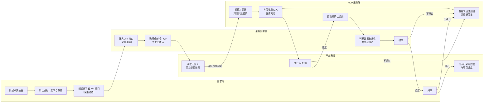

# HCP 数字资产采集平台 PRD

> 版本：V1.1（简版）  
> 状态：待业务评审  
> 使用对象：产品、设计、研发、测试、运营

## 1. 产品概述

### 1.1 产品目标

HCP 数字资产采集平台用于完成医学对话数据从需求提出、任务执行、HCP 参与，到数据审核和最终采用的完整流程。

产品需要解决三个核心问题：

1. 需求方能够把能力提升目标转成明确的采集任务。
2. 采集管理方能够组织 HCP、管理进度并控制数据质量。
3. HCP 能够在明确授权的前提下与 AI 角色完成对话，并看到审核结果。

### 1.2 本期范围

- 需求端：项目创建、API 接口（采集通道）管理、终审和数据分析。
- 采集管理端：接入任务、管理 HCP、数据清洗和初审。
- HCP 采集端：复用元医 AI 职业认证结果，完成知情同意、AI 角色对话、提交和结果查询。
- 公共能力：账号权限、消息通知、数据日志和隐私保护。

本期不包含模型训练、费用结算、合同发票及患者管理功能。

### 1.3 核心术语

以下术语为本 PRD、三端页面、接口字段、埋点和测试用例的统一业务口径。页面可根据空间使用简称，但不得改变定义或混用状态。

#### 1.3.1 业务对象

| 术语 | 正式定义 | 边界与使用说明 |
| --- | --- | --- |
| HCP | Healthcare Professional，即参与专项采集的医疗卫生专业人士。本项目通过元医 AI 已有职业认证结果判断其参与资格 | HCP 是数据贡献者，不是患者；本项目不新建职业认证审核能力 |
| 需求方 | 提出数字资产采集需求、创建项目并对数据完成终审的企业或其授权成员 | 需求方不直接管理 HCP 的完整身份资料，默认仅查看脱敏信息 |
| 采集管理方 | 使用 API 密钥接入项目，负责组织 HCP、判断数据有效性、清洗并初审的企业或其授权成员 | 可同时承接多个采集通道，但数据和权限按企业、项目隔离 |
| 采集项目 | 承载一次完整采集目标的业务容器，包含提升 E 人、提升目标、采集要求、目标数量、采集用 E 人、截止时间等配置 | 一个项目可下发多个采集通道；项目状态控制其下全部通道是否允许发起新对话 |
| API 接口（采集通道） | 需求方在项目下创建、通过 API 密钥授权给一家采集企业的任务接入通道 | 产品展示统一使用“API 接口（采集通道）”；一个通道只能绑定一家采集企业，可设置独立有效数据上限 |
| 采集任务 | 采集通道接入后，面向采集管理方和符合条件 HCP 展示的可执行任务 | 不是独立于项目的新业务实体；其目标、规则和状态继承所属项目及采集通道 |
| 提升 E 人 | 本次项目希望通过已采用数据提升其专业能力、表达能力或场景表现的 AI 角色 | 表示数据最终服务的目标角色，不一定直接参与本次采集对话 |
| 采集用 E 人 | 采集过程中直接与 HCP 进行语音或文字对话的 AI 角色 | 表示 HCP 实际交互对象，界面必须明确其 AI 身份 |
| E 人版本 | 某一 E 人在特定时间点的角色设定、知识、提示词或模型配置版本 | 每条对话记录需保存实际使用的版本，后续升级不得覆盖历史记录 |

提升 E 人和采集用 E 人为正式展示名称。二者可以是同一 AI 角色，也可以是不同角色；项目创建时分别选择。

#### 1.3.2 数据与处理结果

| 术语 | 正式定义 | 边界与使用说明 |
| --- | --- | --- |
| 对话记录 | HCP 开始一次对话后生成的独立记录，包含消息、语音、转写、角色版本、规则版本、时间和过程状态 | 每次重新采集生成新记录，并通过关联关系指向原记录，不覆盖原记录 |
| 采集数据 | 对话记录及其关联的原始语音、原始转写、清洗文本、审核结论和操作记录的统称 | 用于泛指数据对象，不代表已经有效、通过审核或被采用 |
| 已提交数据 | HCP 在 AI 初筛通过后预览并确认提交，且系统已成功受理的对话记录 | 提交后 HCP 不可编辑；后续可能被判无效、驳回、采用或撤回 |
| 有效数据 | 已提交且通过采集管理方有效性判断、进入清洗流程的数据 | “有效”仅表示具备后续处理条件，不等于初审通过或终审采用 |
| 已采用数据 | 通过需求方终审、可计入项目成果和项目完成度的数据 | 是正常链路中的最终业务结果；计数以终审通过成功事件为准且只累计一次 |
| 超额数据 | 在项目已采用数据达到目标后，存量数据继续通过终审而形成的已采用数据 | 仍属于已采用数据，但不使项目完成度超过 100%，数量单独展示 |
| 无效数据 | 经采集管理方判断不满足完整性、时长、主题或其他有效性要求，不能进入清洗和审核的数据 | 对应状态为“已标记无效”，无效原因必填；不计入有效数据和已采用数据 |
| 驳回数据 | 在初审或终审环节未通过的数据 | 驳回不等于无效；需保留所处审核环节、原因和结论，原记录不得删除或改写 |
| 清洗 | 在保留原始语音和原始转写的前提下，对错别字、标点、断句和语音识别错误进行修正 | 不得补充 HCP 未表达的内容、改写原意或直接删除原始版本 |
| 重新采集 | 因 AI 初筛未通过、审核驳回或获得补采机会后，由 HCP 再次完成同一任务的行为 | 生成新的对话记录并保存新旧记录关系；不回退或覆盖原记录状态 |

#### 1.3.3 合规与系统能力

| 术语 | 正式定义 | 边界与使用说明 |
| --- | --- | --- |
| 职业认证结果 | 元医 AI 已有认证功能输出的 HCP 身份及执业资格状态，供本项目读取并判断参与资格 | 本项目不重复保存完整认证资料，也不负责认证审核 |
| 知情同意 | HCP 在开始对话前，对本次采集目的、内容、用途、保护和撤回方式作出的明确授权 | 必须绑定协议版本和同意时间；协议变更后需重新同意 |
| AI 初筛 | HCP 结束对话后，由系统按规则版本执行硬性门槛、质量评分和置信度判断的预处理环节 | 仅决定是否可提交或转人工判断，不替代采集方有效性判断、初审或终审 |
| 脱敏展示 | 在页面、消息或导出中遮盖姓名、手机号、证件号等识别字段的部分内容 | 原始身份数据及映射关系仍可能存在，因此脱敏数据仍属于个人信息 |
| 去标识化 | 将数据中的直接标识符移除或替换，并将映射关系分开、受控保存的处理方式 | 在可通过映射关系重新关联个人时，仍属于可识别、可撤回范围 |
| 不可逆匿名化 | 以合理手段无法识别或重新关联到具体个人，且关联映射关系已销毁的处理结果 | 匿名化完成后无法按个人定位和删除，处理方式需经法务确认 |
| 撤回授权 | HCP 对已提交数据提出停止后续处理或使用的请求及其处理流程 | 撤回处理中暂停清洗、审核、导出和使用；不等同于修改既有审核结论 |

统一口径规则：

1. “采集数据”是对象统称，“有效数据”和“已采用数据”是不同阶段的处理结果，页面和统计不得互换。
2. “AI 初筛通过”只代表允许 HCP 提交，不代表数据有效、初审通过或终审采用。
3. 项目或采集通道“已停止、已暂停、已达标、已完成”只限制新对话；已提交的存量数据仍按规则继续清洗和审核。
4. “重新采集”始终创建新记录；任何清洗、审核、撤回操作均不得覆盖原始语音、原始转写和历史结论。
5. 文中“接口”如无特别说明，均指“API 接口（采集通道）”，不指研发层面的通用系统 API。

### 1.4 核心指标

- 已采用数据量：终审通过的数据数量。
- 终审采用率：终审通过数 / 已终审数。
- 返工率：需要重新采集的数据数 / 已提交数。
- 审核及时率：在约定时限内完成审核的数据占比。
- 合规底线：知情同意缺失、越权访问和未脱敏展示事件均为 0。

## 2. 用户角色

| 角色 | 主要职责 | 核心权限 |
| --- | --- | --- |
| 需求方项目负责人 | 提出需求、管理项目、完成终审 | 项目、API 接口（采集通道）、终审、分析 |
| 采集项目管理员 | 接收任务、邀请 HCP、管理进度 | 接口接入、HCP、任务进度 |
| 数据专员/初审员 | 处理数据并进行初审 | 有效性判断、清洗、初审 |
| HCP 参与者 | 完成认证和对话采集 | 本人任务、本人对话、审核反馈 |
| 企业管理员 | 管理企业成员与角色 | 账号、角色、权限 |

权限原则：用户只能访问所属企业及被授权项目的数据；需求方看到的 HCP 身份和证件默认脱敏；证件查看、数据审核和状态变更必须留痕。

## 3. 功能架构

优先级说明：P0 为首期必须完成，P1 为试点阶段增强能力。

### 3.1 需求端

| 模块 | 主要功能 | 说明 | 优先级 |
| --- | --- | --- | --- |
| 工作台 | 项目与审核概览 | 查看进行中项目、待终审数据和参与 HCP 数 | P1 |
| 采集项目 | 列表、创建、编辑、暂停、完成 | 定义提升目标、采集要求、目标数量和采集用 E 人 | P0 |
| AI 智能补全 | 生成采集要求和建议数量 | 生成内容必须由用户确认后生效 | P0 |
| API 接口（采集通道） | 创建、复制密钥、停止、恢复、完成 | 将项目授权给采集企业，并限制有效数据上限 | P0 |
| 数据集 | 数据列表、详情、状态筛选 | 查看对话、原始语音、处理记录和脱敏后的 HCP 信息 | P0 |
| 终审 | 通过或驳回数据 | 通过后计入已采用数据；驳回必须填写原因 | P0 |
| 数据分析 | 进度、采用率、驳回原因 | 指标可下钻到对应数据列表 | P1 |
| 消息中心 | 待终审和项目异常提醒 | 点击消息进入对应项目或数据 | P1 |

### 3.2 采集管理端

| 模块 | 主要功能 | 说明 | 优先级 |
| --- | --- | --- | --- |
| 工作台 | 任务和数据处理概览 | 查看进行中接口、参与 HCP、待清洗和待初审数量 | P1 |
| API 接口（采集通道） | 接入、列表、详情 | 使用 API 密钥接收需求方下发的采集任务 | P0 |
| HCP 管理 | 列表、新增、认证结果查看 | 手机号用于识别重复 HCP；职业认证结果读取元医 AI 现有数据 | P0 |
| 采集对象 | 选择或手动邀请 HCP | 查看每位 HCP 的对话数、提交数、有效数和最新状态 | P0 |
| 有效性判断 | 标记有效或无效 | 无效原因必填；有效数据进入清洗流程 | P0 |
| 错别字清洗 | 回听语音、修正转写文本 | 只允许修正转写错误，不得改变原意 | P0 |
| 初审 | 通过或驳回数据 | 通过后进入需求端终审；驳回原因同步给 HCP | P0 |
| 系统设置 | 账号、角色、权限 | 审核权、证件查看权和账号管理权独立配置 | P0 |

### 3.3 HCP 采集端

| 模块 | 主要功能 | 说明 | 优先级 |
| --- | --- | --- | --- |
| 登录 | 微信、验证码或密码登录 | 同一手机号关联同一 HCP 账号 | P0 |
| 专项采集 | 任务列表和任务详情 | 展示目标、发起方、对话对象、建议时长和任务状态 | P0 |
| 知情同意 | 阅读并确认协议 | 未同意不得开始；协议变更后需重新同意 | P0 |
| 对话采集 | 与采集用 E 人进行语音或文字对话 | AI 角色发起提问和回应；断网或切换后台时保留已有内容 | P0 |
| AI 初筛 | 进度、结果和原因 | 不通过时允许重新采集；低置信度转人工判断 | P0 |
| 对话提交 | 预览、确认提交、再练一次 | 提交后不可编辑，并防止重复提交 | P0 |
| 历史对话 | 状态查询、反馈查看、重新采集 | 按待处理、审核中、需重采和已采用分类 | P0 |
| 消息中心 | 新任务和审核结果通知 | 点击消息进入对应任务或记录 | P1 |

职业认证为元医 AI 已有功能，不纳入本项目功能清单；本项目仅使用现有认证结果判断 HCP 是否可以参与任务。

## 4. 核心业务流程

泳道职责：需求端负责定义需求和终审；采集管理端负责组织 HCP、处理数据和初审；HCP 采集端负责授权、对话、提交及重采；平台系统负责资格结果读取、AI 初筛和项目进度计数。

流程规则：职业认证不符合要求时不得进入知情同意及对话环节；重新采集会生成新记录，原记录及审核结论保留。

## 5. 关键产品规则

### 5.1 项目与接口

- 项目包含名称、提升 E 人、提升目标、采集要求、目标数量和采集用 E 人。
- AI 生成的要求和建议数量必须可编辑，不得未经确认自动生效。
- 一个项目可创建多个 API 接口（采集通道），每个接口只能绑定一个采集企业。
- 接口状态包括待接入、采集中、已停止、已完成。
- 接口停止后不得发起新对话，但已提交数据继续审核。
- 已产生邀请或数据的接口不能删除，只能停止。

### 5.2 HCP 与对话

- HCP 职业认证由元医 AI 现有功能负责，本项目只读取认证结果，不建设认证审核流程。
- HCP 必须满足项目要求的职业认证条件才能参与采集；未通过时引导至元医 AI 现有认证入口。
- 开始对话前必须同意当前版本的知情同意协议。
- 协议需说明采集目的、内容、用途、保护方式、撤回方式和联系方。
- 实际对话对象为采集用 E 人 AI 角色，不是真人采集员；界面应明确展示 AI 角色身份。
- 对话支持语音和文字；麦克风拒绝授权时提供文字入口。
- 网络中断、切换后台或生成超时时，应保留已有内容并提供继续或重试入口。
- 对话结束后先进行 AI 初筛，初筛通过后才允许提交人工处理。

### 5.3 数据处理与审核

- 数据依次经过：AI 初筛、有效性判断、清洗、初审、终审。
- 清洗只能修正错别字、标点、断句和语音识别错误，原始内容必须保留。
- 初审或终审驳回时原因必填，并同步给相关参与方。
- 初审通过后，采集管理方不能继续修改文本。
- 终审通过后状态变为“已采用”，并计入项目进度。
- 终审结果提交后不可更正；终审通过和终审未通过均为当前版本的终态。
- 所有提交和审核操作都需防止重复点击造成重复数据或重复计数。

### 5.4 隐私与追溯

- HCP 不得在对话中披露患者姓名、联系方式等可识别信息，系统应在采集前提醒。
- 需求方默认只查看脱敏后的 HCP 姓名、手机号和职业认证信息。
- 每条数据需保留知情同意、对话、提交、清洗、初审和终审记录。
- 原始语音、证件和完整身份信息仅向有权限人员开放。
- HCP 可申请撤回授权，具体处理范围和保存期限需由法务确认。

### 5.5 AI 初筛建议方案（待业务评审）

AI 初筛分为“硬性门槛”和“质量评分”两步：

| 类型 | 检查项 | 建议处理 |
| --- | --- | --- |
| 硬性门槛 | 音频和转写是否完整、是否达到最低有效时长和回答数、是否包含明显患者身份信息、是否严重偏离主题 | 任一不通过则初筛不通过，并展示具体原因 |
| 质量评分 | 主题相关性 30 分、任务覆盖度 30 分、回答具体性 25 分、表达自然度及角色一致性 15 分 | 80 分及以上通过；60-79 分转人工；60 分以下不通过 |
| 置信度 | AI 对任一关键结论的置信度 | 低于 0.75 时不自动判定，统一进入待人工判断 |

项目可配置项：最低有效时长、最低有效回答数、必答主题、禁止内容和评分通过线。隐私检查、音频完整性检查和低置信度转人工规则为平台统一规则，项目不可关闭。

建议初始默认值为：最低有效时长 5 分钟、HCP 有效回答不少于 6 次、评分通过线 80 分。试点期间根据人工复核结果调整，所有初筛结果需保存规则版本和原因。

### 5.6 提交上限、截止时间与超额处理建议（待业务评审）

- 单个 HCP 在同一项目中默认最多提交 5 条数据，项目负责人可在 1-20 条范围内调整。
- 所有成功提交均计入上限；因审核驳回需要重采时，项目管理员可为指定 HCP 增加 1 次补采机会，并记录原因。
- 项目必须设置截止时间，默认开始采集后 30 天；截止前 3 天提醒需求方、采集方和仍有未提交记录的 HCP。
- 到达截止时间后不得发起新对话；已在进行中的对话可完成，待提交记录保留 24 小时提交期，之后自动标记为已放弃。
- 已采用数据达到项目目标后，项目自动进入“已达标”，并停止发起新对话；存量数据继续完成审核。
- 超出目标后通过终审的数据标记为“超额数据”，不使完成度超过 100%。需求方可提高目标并恢复采集，或确认完成项目。
- API 接口（采集通道）的有效数据上限独立生效；任一项目级或接口级上限达到后，都应停止该范围内的新对话。

### 5.7 数据保存与撤回建议（待法务及业务评审）

建议保存期限从项目完成之日起计算：

| 数据类型 | 建议保存期限 | 到期处理 |
| --- | --- | --- |
| 原始语音、原始转写 | 1 年 | 删除，或在获得合法授权后做不可逆匿名化 |
| 清洗文本、审核版本、已采用数据 | 3 年 | 删除或不可逆匿名化 |
| 知情同意记录、审核记录、操作日志 | 5 年 | 到期删除；法律或合同另有要求时从其规定 |
| 职业认证资料 | 不在本项目重复保存 | 由元医 AI 现有认证功能按其规则管理 |

撤回流程建议：

1. HCP 在历史对话中选择具体记录并提交撤回申请，可填写原因。
2. 记录进入“撤回处理中”，立即暂停后续清洗、审核、导出和使用。
3. 授权人员在 5 个工作日内判断数据是否仍可识别到个人，并完成处理。
4. 可识别或仅去标识化的数据，应停止使用并按规则删除，同时通知相关项目方。
5. 已完成不可逆匿名化、无法再关联到个人的数据无法单独定位和删除，应向 HCP 说明原因和处理结果。
6. 撤回完成后状态变为“已撤回”；如申请不成立，应说明原因并恢复申请前状态。

去标识化数据仍可通过映射关系关联个人，属于可撤回范围；只有无法合理恢复个人身份且映射关系已销毁的数据，才视为不可逆匿名化数据。

## 6. 状态与统计口径

### 6.1 项目状态

项目主流程：`草稿 -> 采集中 <-> 已暂停`；达到目标后进入 `已达标 -> 已完成`。

其中“已达标”和截止时间相关流转采用第 5.6 节建议方案，评审通过后生效。

| 状态 | 进入条件 | 允许操作 | 下一状态 |
| --- | --- | --- | --- |
| 草稿 | 项目已保存，但尚无接口接入采集企业 | 编辑全部信息、创建 API 接口（采集通道）、删除项目 | 采集中 |
| 采集中 | 项目下首个接口接入成功，系统自动启动项目 | 查看进度、有限编辑、创建接口、暂停或完成项目 | 已暂停、已达标、已完成 |
| 已暂停 | 需求方主动暂停或到达项目截止时间 | 查看和处理存量数据、恢复或完成项目 | 采集中、已完成 |
| 已达标 | 已采用数据达到项目目标，系统停止新对话 | 处理存量数据、提高目标、确认完成 | 采集中、已完成 |
| 已完成 | 需求方确认结束项目 | 查看、审核存量数据和归档 | 无，属于终态 |

规则：

- 项目暂停后，所属接口同步停止产生新对话；进行中的对话允许完成并提交。
- 项目完成前需展示仍在对话、待提交和待审核的数据数量，并由负责人二次确认。
- 项目因到期暂停时需记录“已到期”原因；延长截止时间后可恢复采集。
- 项目达到目标后自动进入“已达标”；提高目标后可重新进入“采集中”。
- 已完成项目不得新增接口或新对话，但存量数据可继续完成清洗和审核。
- 已完成项目不允许直接恢复；如需追加采集，应创建新项目或复制项目，具体方式待业务确认。

### 6.2 API 接口（采集通道）状态

接口主流程：`待接入 -> 采集中 <-> 已停止 -> 已完成`

| 状态 | 进入条件 | 允许操作 | 下一状态 |
| --- | --- | --- | --- |
| 待接入 | 需求方已创建接口，但尚未绑定采集企业 | 编辑、复制 API 密钥、删除 | 采集中 |
| 采集中 | 采集企业使用有效 API 密钥接入成功 | 邀请 HCP、发起对话、查看进度、停止或完成 | 已停止、已完成 |
| 已停止 | 需求方停止接口，或所属项目被暂停 | 查看和处理存量数据、恢复或完成 | 采集中、已完成 |
| 已完成 | 需求方确认该接口不再采集 | 查看和处理存量数据 | 无，属于终态 |

规则：

- API 密钥只能成功绑定一个采集企业；重复绑定不改变接口状态。
- 接口停止或完成后，HCP 不得发起新对话，已提交数据继续处理。
- 仅“待接入”且没有邀请或数据的接口可以删除；其他状态只能停止或完成。
- 接口达到有效数据上限时停止接收新对话，并提示需求方决定提高上限或完成接口。
- 项目暂停引起的接口停止，应在项目恢复时恢复至暂停前状态；人工停止的接口不自动恢复。

### 6.3 对话数据状态

主链路：

`对话中 -> AI 初筛中 -> 待提交 -> 已提交（待有效性判断） -> 待清洗 -> 待初审 -> 待终审 -> 已采用`

其中“撤回处理中”和“已撤回”采用第 5.7 节建议方案，法务及业务评审通过后生效。

| 状态 | 进入条件 | 可执行操作 | 下一状态 |
| --- | --- | --- | --- |
| 对话中 | HCP 同意协议并开始本次对话 | 继续对话、切换语音/文字、确认结束 | AI 初筛中 |
| AI 初筛中 | HCP 确认结束对话 | 等待结果 | 待提交、AI 初筛未通过、待人工判断 |
| 待人工判断 | AI 超时、失败或低置信度，无法可靠给出结论 | 授权人员判断通过或不通过 | 待提交、AI 初筛未通过 |
| AI 初筛未通过 | AI 或人工判断未达到最低质量要求 | 查看原因、重新采集 | 无，当前记录终止 |
| 待提交 | AI 初筛通过，等待 HCP 确认 | 预览、确认提交、再练一次或放弃 | 已提交（待有效性判断）、已放弃 |
| 已放弃 | HCP 在提交前明确放弃、选择“再练一次”，或超过截止后的提交保留期 | 查看记录 | 无，当前记录终止 |
| 已提交（待有效性判断） | HCP 确认提交成功 | 采集方标记有效或无效 | 待清洗、已标记无效 |
| 已标记无效 | 采集方确认数据不可进入审核 | 查看无效原因 | 无，当前记录终止 |
| 待清洗 | 采集方确认数据有效 | 回听语音、修正转写、完成清洗 | 待初审 |
| 待初审 | 清洗完成并保存 | 初审通过或驳回 | 待终审、初审未通过 |
| 初审未通过 | 初审员判定不符合采集要求 | 查看原因、重新采集 | 无，当前记录终止 |
| 待终审 | 初审通过并提交需求方 | 终审通过或驳回 | 已采用、终审未通过 |
| 终审未通过 | 需求方判定不采用 | 查看原因、重新采集 | 无，当前记录终止 |
| 已采用 | 终审通过 | 查看和纳入项目成果 | 无，正常终态 |
| 撤回处理中 | HCP 对已提交数据发起撤回申请 | 授权人员批准或拒绝申请 | 已撤回、恢复申请前状态 |
| 已撤回 | 撤回申请获批 | 仅查看必要的处理记录 | 无，属于终态 |

补充规则：

- 在“对话中”发生断网、后台切换或来电时，状态不变，恢复后继续当前对话。
- “再练一次”会将当前待提交记录标记为“已放弃”并创建新记录；从未通过记录发起“重新采集”会创建新记录，原记录保持未通过状态。两种情况都需保存新旧记录关联关系。
- AI 初筛、无效判断、初审和终审未通过时，必须保存原因；失败状态不得直接改为通过。
- 终审结果暂不支持更正；“已采用”和“终审未通过”均不可改为其他审核结论。撤回数据属于授权处理，不属于终审更正。
- 撤回申请可从“已提交（待有效性判断）”至“已采用”之间发起；处理期间暂停清洗和审核。申请被拒绝时恢复申请前状态。
- 状态变化失败或重复提交时保持原状态，不得重复累计数量。

### 6.4 统计口径

| 指标 | 计算口径 |
| --- | --- |
| 已对话数 | 已确认结束并进入过“AI 初筛中”的记录数，包括之后未通过或未提交的记录 |
| 已提交数 | HCP 曾成功确认提交的记录数，包括之后无效、驳回或采用的记录 |
| 有效数据数 | 曾被采集方标记有效并进入“待清洗”的记录数 |
| 待清洗数 | 当前状态为“待清洗”的记录数 |
| 待初审数 | 当前状态为“待初审”的记录数 |
| 待终审数 | 当前状态为“待终审”的记录数 |
| 未通过数 | 当前处于 AI 初筛未通过、已标记无效、初审未通过或终审未通过的记录数 |
| 已采用数据数 | 当前状态为“已采用”的记录数；撤回后从该数量中扣除 |
| 项目完成度 | 已采用数据数 / 项目目标数量，超过目标时最高显示 100%，同时单独展示超出数量 |

同一条记录只计入一个当前状态数量；“已对话数、已提交数、有效数据数”属于累计过程指标，因此可同时包含同一条记录。

## 7. P0 验收标准

| 场景 | 验收结果 |
| --- | --- |
| 创建项目 | 必填项完整并确认 AI 结果后可创建；创建后可生成 API 接口（采集通道） |
| 接入接口 | 有效密钥可接入；无效、停用或已绑定密钥需阻止并说明原因 |
| 邀请 HCP | 可从 HCP 库选择或手动新增；重复手机号不得重复建档 |
| 职业认证 | 系统读取元医 AI 现有认证结果；未满足资格时不能开始对话，并引导至现有认证入口 |
| 知情同意 | 未勾选不能开始；同意后记录协议版本、签署人和时间 |
| 对话异常 | 断网或切换后台后已有内容不丢失；麦克风拒绝时可改用文字 |
| AI 初筛 | 建议方案评审通过后，按项目规则完成硬性检查和质量评分；低置信度进入人工判断，不得自动通过或驳回 |
| 数据提交 | 提交后二次确认、不可编辑；连续点击只产生一条记录 |
| 数据清洗 | 可对照语音修正文本；未保存修改时不能完成清洗 |
| 初审 | 驳回原因必填；通过后文本锁定并进入需求端待终审 |
| 终审 | 通过后已采用数量增加一次；驳回原因同步给采集方和 HCP；结论提交后不可更正 |
| 权限与脱敏 | 无权限用户不能查看或操作敏感数据，需求方看到的 HCP 信息默认脱敏 |
| 停止接口 | 停止后不能发起新对话，但存量数据仍可继续处理 |
| 达到目标 | 建议方案评审通过后，已采用数据达到目标即停止新对话并进入已达标；提高目标后可恢复采集 |

## 8. 决策记录

### 8.1 已确认

1. 正式名称使用“提升 E 人”和“采集用 E 人”。
2. 采集对话由 HCP 与采集用 E 人 AI 角色完成，不是真人采集员对话。
3. HCP 职业认证复用元医 AI 已有功能，本项目不建设认证审核。
4. 终审结论暂不支持更正。

### 8.2 待评审建议

以下建议可作为原型和研发评估基线，评审通过后转为正式规则：

1. AI 初筛采用第 5.5 节的硬性门槛、质量评分及低置信度转人工方案。
2. 单人上限、项目截止时间和超额处理采用第 5.6 节方案。
3. 数据保存、撤回授权和匿名化处理采用第 5.7 节方案，并需法务确认。

## 9. 原型说明

当前原型已覆盖三端主要页面和核心审核链路，可用于确认信息架构与交互方向。原型中的固定姓名、数量、日期和演示数据不作为正式业务规则；最终实现以本 PRD 评审结论为准。
